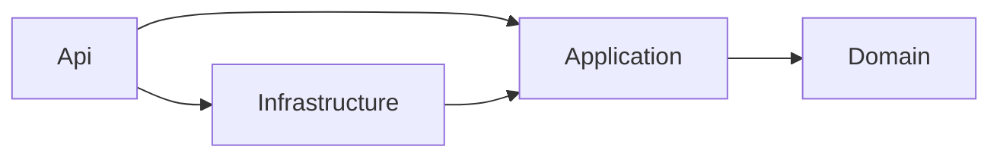

# ניהול פניות מארגונים ומעסיקים

[](https://github.com/Batsheva-s/employer-requests/actions/workflows/ci.yml)

מערכת לניהול פניות שמגיעות מארגונים ומעסיקים, לעבודה של כמה משתמשים במקביל על 100,000 פניות ויותר.
המשתמשים מאתרים פניות ומסננים, ממיינים ומדפדפים – הכול בצד השרת – רואים נתונים מסכמים, מעדכנים סטטוס של פנייה אחת או של עד 100 פניות בבת אחת, וצופים בהיסטוריית השינויים. עדכון של משתמש אחד לעולם לא דורס בשקט עדכון של משתמש אחר.

| מסמך | מה יש בו |
|---|---|
| README (כאן) | הרצה, טכנולוגיות, מבנה, API, בסיס הנתונים, Concurrency, ‏Bulk, ‏Cache, החלטות, מגבלות, שימוש ב-AI |
| [docs/WORK_PLAN.md](docs/WORK_PLAN.md) | תוכנית העבודה: דרישות, הנחות, החלטות, משימות עם תלויות והערכות, סדר ביצוע, נתיב קריטי |
| [docs/PERFORMANCE.md](docs/PERFORMANCE.md) | מדידות על 100,000 פניות: תוכניות ביצוע, אינדקסים, צוואר בקבוק והצעת שיפור |

## תוכן

1. [הרצה](#הרצה)
2. [מה לנסות](#מה-לנסות)
3. [טכנולוגיות וגרסאות](#טכנולוגיות-וגרסאות)
4. [מבנה הפתרון](#מבנה-הפתרון)
5. [API](#api)
6. [בסיס הנתונים והאינדקסים](#בסיס-הנתונים-והאינדקסים)
7. [עדכון סטטוס ותחרותיות](#עדכון-סטטוס-ותחרותיות)
8. [עדכון מרוכז (Bulk)](#עדכון-מרוכז-bulk)
9. [Cache](#cache)
10. [הלקוח – Angular](#הלקוח--angular)
11. [טיפול בשגיאות ו-Logging](#טיפול-בשגיאות-ו-logging)
12. [בדיקות אוטומטיות](#בדיקות-אוטומטיות)
13. [החלטות טכנולוגיות וחלופות](#החלטות-טכנולוגיות-וחלופות)
14. [מגבלות ידועות ושיפורים](#מגבלות-ידועות-ושיפורים)
15. [שימוש בכלי AI](#שימוש-בכלי-ai)

## הרצה

**דרישות:** ‎.NET 9 SDK · Node.js 20.19+ / 22.12+ / 24 · SQL Server LocalDB (מותקן עם Visual Studio), או Docker במקומו.

### Windows עם LocalDB

```bash
git clone https://github.com/Batsheva-s/employer-requests
cd employer-requests

# טרמינל 1 – השרת. בהרצה הראשונה: יצירת בסיס הנתונים (Migrations) וטעינת 100,000 פניות
dotnet run --project src/EmployerRequests.Api

# טרמינל 2 – הלקוח
cd client
npm ci
npm start
```

| כתובת | מה יש שם |
|---|---|
| http://localhost:4200 | הממשק |
| http://localhost:5080/swagger | כל ה-Endpoints, עם התיאורים וקודי התשובה |

ה-Angular Dev Server מעביר כל קריאה ל-`/api` אל השרת ([`proxy.conf.json`](client/proxy.conf.json)), כך שהדפדפן רואה כתובת אחת ואין צורך ב-CORS.
בקשות מוכנות לניסוי ידני (Visual Studio / VS Code REST Client): [`EmployerRequests.Api.http`](src/EmployerRequests.Api/EmployerRequests.Api.http).

### בלי LocalDB (Mac, Linux, או Windows עם Docker)

[`docker-compose.yml`](docker-compose.yml) מריץ SQL Server 2022 בקונטיינר:

```bash
docker compose up -d --wait
export ConnectionStrings__Requests="Server=localhost,1433;Database=EmployerRequests;User Id=sa;Password=Local_Dev_Pass_123!;TrustServerCertificate=True"
dotnet run --project src/EmployerRequests.Api
```

ב-PowerShell: `$env:ConnectionStrings__Requests = "..."` במקום `export`. הלקוח זהה בשני המסלולים.

### יצירה מחדש של נתוני הבדיקה

```bash
dotnet run --project src/EmployerRequests.Api -- seed           # מוחק את בסיס הנתונים ויוצר אותו מחדש עם 100,000 פניות
dotnet run --project src/EmployerRequests.Api -- seed 250000    # כמות אחרת (עד 1,000,000)
```

הנתונים בדויים ונוצרים מ-Seed אקראי קבוע, כך שכל יצירה מחדש מייצרת אותן פניות. התאריכים יחסיים לרגע היצירה, ולפניות שנוצרו כך אין היסטוריה – היא מתחילה בשינוי הראשון שנעשה דרך המערכת. לפני הפקודה עוצרים את השרת אם הוא רץ: היא מוחקת את בסיס הנתונים שהוא עובד מולו. הפקודה עובדת רק בסביבת Development.

### בדיקות

```bash
# שרת: יחידה + Integration מול SQL Server
dotnet test

# לקוח
cd client
npm test -- --watch=false
```

בדיקות ה-Integration יוצרות בסיס נתונים משלהן (אחד לכל מחלקת בדיקות) ומוחקות אותו בסוף. ברירת המחדל היא LocalDB; לשרת אחר מגדירים מחרוזת התחברות (בלי שם בסיס נתונים) במשתנה `TESTS_SQLSERVER_CONNECTION`, למשל מול ה-Docker:
`Server=localhost,1433;User Id=sa;Password=Local_Dev_Pass_123!;TrustServerCertificate=True`.

## מה לנסות

1. **סינון, חיפוש, מיון ודפדוף – בצד השרת.** כל שינוי מבקש מהשרת עמוד אחד. בכלי המפתחים של הדפדפן (F12 ← Network) רואים שבזמן הקלדה בשדה החיפוש יוצאות בקשות רק 300ms אחרי ההקשה האחרונה – אחת לרשימה ואחת לסיכום – ושבקשה שעוד לא חזרה כשהסינון השתנה מסומנת `(canceled)`: הדפדפן ביטל אותה, והשרת ביטל את השאילתה שלה.
2. **עדכון סטטוס והיסטוריה.** כותבים שם בשדה "שם המשתמש/ת" בראש המסך – במבחן אין התחברות, וזה השם שנרשם בהיסטוריה. לחיצה על פנייה פותחת את פרטיה: הרשימה מציעה רק את הסטטוסים שמותר לעבור אליהם, וליד הכפתור כתוב על שם מי יירשם השינוי. אחרי העדכון, השורה החדשה מסומנת ב"היסטוריית שינויי הסטטוס" שבתחתית החלון: מתי, מאיזה סטטוס לאיזה, ומי. לפניות של נתוני הבדיקה ההיסטוריה מתחילה ריקה – היא מתעדת שינויים שנעשו דרך המערכת.
3. **שני משתמשים על אותה פנייה (409).** פותחים את אותה פנייה בשתי לשוניות. מעדכנים סטטוס בראשונה, ואחר כך בשנייה, שעדיין מציגה את הגרסה הקודמת. השנייה מקבלת הודעה שהפנייה עודכנה בינתיים והשינוי שלה לא נשמר, והחלון מציג את המצב העדכני – כולל השינוי של הלשונית הראשונה בהיסטוריה.
4. **עדכון מרוכז.** מסמנים כמה פניות, כולל אחת בסטטוס "הושלמה", ובוחרים "ממתינה". התוצאה מפרטת כמה פניות עודכנו, ולכל פנייה שלא עודכנה – למה (מ"הושלמה" אפשר לעבור רק ל"בטיפול").
5. **נתונים מסכמים.** הכרטיסים בראש המסך מחושבים לפי אותו סינון כמו הרשימה, ומתעדכנים אחרי כל שינוי סטטוס: בסגירת חלון הפרטים, ומיד אחרי עדכון מרוכז. "נכון לשעה" מתחתם הוא הרגע שבו המספרים חושבו: בלי סינון הם מגיעים מה-Cache, ולכן השעה נשארת עד דקה – או עד שינוי הסטטוס הבא.
6. **ב-Swagger:** ‏`pageSize=500` מחזיר 400 עם שם השדה; מעבר סטטוס אסור מחזיר 422 עם הסטטוסים המותרים; גרסה ישנה מחזירה 409.

## טכנולוגיות וגרסאות

| חלק | טכנולוגיה | גרסה |
|---|---|---|
| שרת | ‏.NET, ‏ASP.NET Core Web API (Controllers) | 9.0 |
| גישה לנתונים | EF Core – ‏Code First ו-Migrations | 9.0.21 |
| בסיס נתונים | SQL Server – ‏LocalDB בפיתוח; ‏SQL Server 2022 ב-CI | 2016 ומעלה |
| תיעוד ה-API | Swashbuckle (Swagger UI) | 10.3.1 |
| בדיקות שרת | xUnit, ‏`WebApplicationFactory` | 2.9.3 |
| לקוח | Angular – רכיבי Standalone, ‏Signals, בלי zone.js | 21.2 |
| רכיבי ממשק | Angular Material | 21.2 |
| | RxJS, ‏TypeScript | 7.8, ‏5.9 |
| בדיקות לקוח | Vitest דרך ה-Angular CLI | 4.1 |
| CI | GitHub Actions: בנייה ובדיקות של השרת (מול SQL Server בקונטיינר) ושל הלקוח | |

**על ‎.NET 9:** זו הגרסה שמותקנת בסביבת הפיתוח. התמיכה בה מסתיימת ב-10 בנובמבר 2026. המעבר ל-‎.NET 10 ‏(LTS) הוא שינוי של `TargetFramework` ב-[`Directory.Build.props`](Directory.Build.props) ושל גרסאות החבילות ב-[`Directory.Packages.props`](Directory.Packages.props). ‏[`global.json`](global.json) מאפשר לבנות גם עם SDK חדש יותר (כללי הניתוח נשארים של ‎.NET 9), אבל כדי להריץ צריך את ה-Runtime של ‎.NET 9 – הוא מגיע עם ה-SDK.

## מבנה הפתרון

ארבעה פרויקטים, והחלוקה המוכרת בתוכם: Controller ← Service ← Repository ← DbContext.

```text
src/
  EmployerRequests.Api/                      שכבת ה-HTTP
    Controllers/RequestsController.cs          כל ה-Endpoints: מקבל בקשה, קורא לשירות, מחזיר תשובה
    ErrorHandling/GlobalExceptionHandler.cs    חריגה ← תשובת שגיאה אחידה (Problem Details)
    Program.cs                                 הגדרות, רישום כל המחלקות ב-DI, הכנת בסיס הנתונים
  EmployerRequests.Application/              הלוגיקה העסקית
    DTOs/                                      מה שנכנס ל-API ויוצא ממנו, עם כללי הוולידציה
    Interfaces/                                IRequestService, ‏IRequestRepository
    Services/RequestService.cs                 כל הפעולות על פניות: חיפוש, פרטים, היסטוריה, סיכום, עדכון סטטוס, עדכון מרוכז
    Services/SummaryCache.cs                   ה-Cache של הסיכום
    Mapping/RequestMapper.cs                   ישות ← DTO, במקום אחד
    Exceptions/                                NotFoundException, ‏ConcurrencyConflictException
  EmployerRequests.Domain/                   הישויות וכללי העסק – בלי תלות בשום ספרייה
    ServiceRequest.cs                          הפנייה; הסטטוס משתנה רק דרך ChangeStatus
    RequestStatusChange.cs                     שורה בהיסטוריית השינויים
    StatusWorkflow.cs                          מעברי הסטטוס המותרים
    RequestStatus.cs, RequestPriority.cs, InvalidStatusTransitionException.cs
  EmployerRequests.Infrastructure/           בסיס הנתונים
    Data/AppDbContext.cs                       הטבלאות, העמודות והאינדקסים (Code First)
    Data/Migrations/                           נוצרו מ-AppDbContext
    Data/TestDataSeeder.cs                     100,000 פניות לבדיקה, ויצירה מחדש שלהן
    Repositories/RequestRepository.cs          כל השאילתות: סינון, מיון, דפדוף, קיבוץ, שמירה
tests/
  EmployerRequests.UnitTests/                בלי בסיס נתונים: כללי הסטטוס, ולידציה, ה-Cache, לוגיקת העדכון
  EmployerRequests.IntegrationTests/         ה-API כולו מול SQL Server אמיתי
client/                                      Angular
docs/                                        תוכנית העבודה, ביצועים
```



**מסלול של בקשה:** [`RequestsController`](src/EmployerRequests.Api/Controllers/RequestsController.cs) (רק HTTP) ← [`RequestService`](src/EmployerRequests.Application/Services/RequestService.cs) (ההחלטות) ← [`ServiceRequest`](src/EmployerRequests.Domain/ServiceRequest.cs) (כללי העסק) ו-[`RequestRepository`](src/EmployerRequests.Infrastructure/Repositories/RequestRepository.cs) (השאילתות) ← [`AppDbContext`](src/EmployerRequests.Infrastructure/Data/AppDbContext.cs) ‏(EF Core) ← SQL Server.

**כיוון התלויות:** ה-Domain לא תלוי בשום דבר. ה-Application מגדיר את `IRequestRepository` ולא מכיר את EF Core; ‏Infrastructure מממש אותו. ‏Api מכיר את כולם, כי ב-[`Program.cs`](src/EmployerRequests.Api/Program.cs) נרשמות כל המחלקות. כך הלוגיקה נבדקת בלי בסיס נתונים, והקומפיילר לא מאפשר לשכבה פנימית להשתמש בשכבה חיצונית.

| רכיב | Lifetime | למה |
|---|---|---|
| `AppDbContext` | Scoped | אחד לכל בקשת HTTP – יחידת עבודה אחת. ‏DbContext אינו בטוח לשימוש מכמה Threads |
| `RequestRepository`, ‏`RequestService` | Scoped | עובדים עם ה-DbContext של אותה בקשה |
| `SummaryCache` (ו-`IMemoryCache`) | Singleton | הסיכום השמור ומונה הגרסאות משותפים לכל המשתמשים |
| `TestDataSeeder` | Scoped | רץ בעלייה, בתוך Scope משלו |

## API

התיעוד המלא, עם התיאורים וקודי התשובה, ב-Swagger: ‏http://localhost:5080/swagger.

| Method | נתיב | מה עושה | תשובות |
|---|---|---|---|
| GET | `/api/requests` | חיפוש: עמוד אחד של פניות | 200, ‏400 |
| GET | `/api/requests/summary` | נתונים מסכמים לאותם סינונים: לפי סטטוס, לפי עדיפות, וחמשת המטפלים עם הכי הרבה פניות פתוחות | 200, ‏400 |
| GET | `/api/requests/{id}` | פנייה אחת, עם הגרסה שלה והסטטוסים שמותר לעבור אליהם | 200, ‏404 |
| GET | `/api/requests/{id}/history` | היסטוריית הסטטוסים, מהחדש לישן | 200, ‏404 |
| PATCH | `/api/requests/{id}/status` | עדכון סטטוס של פנייה אחת | 200, ‏400, ‏404, ‏409, ‏422 |
| PATCH | `/api/requests/status` | עדכון סטטוס של עד 100 פניות | 200, ‏400 |

**פרמטרים של החיפוש** (גם הסיכום מקבל את פרמטרי הסינון):

| פרמטר | משמעות | ברירת מחדל וגבולות |
|---|---|---|
| `page`, `pageSize` | דפדוף | ‏1 ו-20; ‏`pageSize` עד 100 |
| `sortBy` | `createdAt`, ‏`updatedAt`, ‏`title`, ‏`organizationName`, ‏`status`, ‏`priority` | `createdAt` |
| `sortDirection` | `asc` או `desc` | `desc` |
| `search` | מכיל – בכותרת או בשם הארגון | עד 100 תווים |
| `status`, `priority` | ערך אחד או יותר: `?status=New&status=Waiting` | |
| `organizationName`, `assignedTo` | מתחיל ב- | |
| `createdFrom`, `createdTo` | טווח חצי פתוח: `createdFrom <= CreatedAt < createdTo` | `createdTo` אחרי `createdFrom` |

כל הסינונים משולבים ב-AND. המיון תמיד מסתיים ב-`Id`, כך שהסדר יציב גם כשלכמה פניות יש אותו ערך, ואף פנייה לא מופיעה בשני עמודים או נעלמת בין עמודים.

**עדכון סטטוס** – הגוף כולל את הגרסה שהמשתמש ראה:

```http
PATCH /api/requests/42/status
X-User-Name: %D7%A9%D7%A8%D7%94%20%D7%9B%D7%94%D7%9F

{ "status": "InProgress", "rowVersion": "AAAAAAAAB9E=" }
```

**עדכון מרוכז** – גרסה לכל פנייה, ותוצאה לכל פנייה:

```http
PATCH /api/requests/status

{ "status": "Waiting", "items": [ { "id": 1, "rowVersion": "AAAAAAAAB9E=" }, { "id": 2, "rowVersion": "AAAAAAAAB9I=" } ] }
```

```json
{
  "requested": 2, "succeeded": 1, "failed": 1,
  "items": [
    { "id": 1, "outcome": "Updated", "message": null, "rowVersion": "AAAAAAAAB+0=" },
    { "id": 2, "outcome": "Conflict", "message": "The request was changed by another user.", "rowVersion": null }
  ]
}
```

**שגיאות** מוחזרות כ-[Problem Details](https://www.rfc-editor.org/rfc/rfc9457) – פורמט אחד לכל השגיאות. ‏400 כולל את השדות הלא תקינים (`errors`), ו-422 כולל את הסטטוס הנוכחי ואת הסטטוסים המותרים (`allowedStatuses`).

**מי ביצע את השינוי:** הכותרת `X-User-Name`, מקודדת ב-URL encoding (כותרות HTTP הן ASCII, ושמות יכולים להיות בעברית). ה-Controller קורא אותה (`[FromHeader]`) ומעביר את השם לשירות. באפיון אין הזדהות; ראו [מגבלות](#מגבלות-ידועות-ושיפורים).

## בסיס הנתונים והאינדקסים

**למה SQL Server:** הנתונים מובנים וקשורים זה לזה (פנייה ושורות ההיסטוריה שלה); שינוי סטטוס ושורת ההיסטוריה שלו נשמרים יחד בטרנזקציה אחת; ‏`rowversion` נותן Optimistic Concurrency מובנה; והסינון המשולב, המיון והקיבוץ הם בדיוק מה שאינדקסים ו-`GROUP BY` עושים היטב – עם תוכניות ביצוע שאפשר למדוד. זה גם מה שמותקן בסביבת הפיתוח (LocalDB). ב-MongoDB אפשר היה לשמור את ההיסטוריה בתוך מסמך הפנייה ולממש גרסה בשדה ייעודי, אבל הסכמה כאן קבועה, והשאילתות טבעיות יותר ב-SQL.

**`Requests`**

| עמודה | סוג | הערה |
|---|---|---|
| `Id` | `int` identity | מפתח ראשי, Clustered |
| `Title` | `nvarchar(200)` | |
| `OrganizationName` | `nvarchar(200)` | |
| `Status`, `Priority` | `tinyint` | Enum. בייט אחד בטבלה ובאינדקסים; ב-JSON – השם (`"InProgress"`) |
| `AssignedTo` | `nvarchar(100)` NULL | |
| `CreatedAt`, `UpdatedAt` | `datetimeoffset` | רגע מדויק בזמן, בלי בלבול בין אזורי זמן |
| `RowVersion` | `rowversion` | SQL Server משנה אותה אוטומטית בכל עדכון של השורה – ה-Concurrency Token |

**`RequestStatusChanges`** – שורה לכל שינוי סטטוס: ‏`Id` (`bigint`), ‏`RequestId` (מפתח זר, ‏Cascade), ‏`PreviousStatus`, ‏`NewStatus`, ‏`ChangedBy`, ‏`ChangedAt`.

**האינדקסים** – כל אחד מתאים לדפוס שאילתה, ונמדד עם ובלי ([PERFORMANCE.md](docs/PERFORMANCE.md#3-האינדקסים--ולמה-כל-אחד)):

| אינדקס | עמודות | משרת את |
|---|---|---|
| `PK_Requests` | `Id` (Clustered) | פנייה לפי מזהה; העדכון |
| `IX_Requests_CreatedAt` | `CreatedAt` | המיון ברירת המחדל – החדשות קודם – וטווח התאריכים |
| `IX_Requests_Status_CreatedAt` | `Status`, ‏`CreatedAt` + ‏`INCLUDE (Priority)` | סינון לפי סטטוס עם המיון ברירת המחדל; הסיכום לפי סטטוס ועדיפות – מהאינדקס בלבד, בלי לקרוא את הטבלה |
| `IX_Requests_OrganizationName` | `OrganizationName` | "שם הארגון מתחיל ב-" |
| `IX_Requests_AssignedTo_Status` | `AssignedTo`, ‏`Status` | "המטפל/ת מתחיל ב-"; חמשת המטפלים עם הכי הרבה פניות פתוחות |
| `IX_RequestStatusChanges_RequestId_ChangedAt` | `RequestId`, ‏`ChangedAt` | ההיסטוריה של פנייה, מהחדש לישן; משמש גם את המפתח הזר |

הסכמה נוצרת מה-Migrations ([`Data/Migrations`](src/EmployerRequests.Infrastructure/Data/Migrations)); בפיתוח השרת מריץ אותן בעלייה. Migration חדש:

```bash
dotnet tool restore
dotnet ef migrations add <Name> --project src/EmployerRequests.Infrastructure --startup-project src/EmployerRequests.Api
```

**נתוני הבדיקה:** ‏100,000 פניות בעברית, בדויות: ‏200 ארגונים, ‏30 מטפלים, תאריכים בשנתיים האחרונות; ‏20% חדשות, ‏30% בטיפול, ‏15% ממתינות, ‏35% הושלמו. הן נטענות ב-`SqlBulkCopy` (כמה שניות), ואחר כך האינדקסים נבנים מחדש. הקוד: [`TestDataSeeder`](src/EmployerRequests.Infrastructure/Data/TestDataSeeder.cs).

**איך נמנעת טעינה של כל הנתונים לזיכרון:** כל קריאה נבנית כשאילתת `IQueryable` אחת ש-SQL Server מריץ במלואה – הסינון (`WHERE`), המיון (`ORDER BY`), הדפדוף (`OFFSET/FETCH`) והקיבוץ (`GROUP BY`). ‏`Select` ל-DTO בתוך השאילתה מוציא מבסיס הנתונים רק את העמודות הנדרשות, ורק את 20 השורות של העמוד. ‏`AsNoTracking` חוסך את מעקב השינויים בקריאות. אין `ToList` לפני סינון. ה-SQL שנוצר בפועל, תוכניות הביצוע והמדידות: [`docs/PERFORMANCE.md`](docs/PERFORMANCE.md).

## עדכון סטטוס ותחרותיות

הבעיה: שני משתמשים טוענים את אותה פנייה ומשנים אותה. בלי הגנה, השמירה השנייה דורסת את הראשונה בשקט (Lost Update). הפתרון: **Optimistic Concurrency** עם עמודת `rowversion`.

1. כל פנייה מגיעה ללקוח עם `rowVersion`.
2. בעדכון, הלקוח שולח את הסטטוס החדש ואת ה-`rowVersion` שהמשתמש רואה.
3. [`RequestService`](src/EmployerRequests.Application/Services/RequestService.cs) טוען את הפנייה (404 אם אינה קיימת) ומשווה גרסאות. גרסה אחרת פירושה שמישהו שינה את הפנייה אחרי שהמשתמש טען אותה – ‏409, ושום דבר לא משתנה.
4. [`ServiceRequest.ChangeStatus`](src/EmployerRequests.Domain/ServiceRequest.cs) בודק את המעבר מול [`StatusWorkflow`](src/EmployerRequests.Domain/StatusWorkflow.cs) (‏422 אם אינו מותר), מעדכן את הסטטוס ואת `UpdatedAt`, ומוסיף שורת היסטוריה.
5. ‏`SaveChanges` שולח, בטרנזקציה אחת, את ה-INSERT של ההיסטוריה ואת:
   ```sql
   UPDATE [Requests] SET [Status] = @p5, [UpdatedAt] = @p6
   OUTPUT INSERTED.[RowVersion]
   WHERE [Id] = @p7 AND [RowVersion] = @p8;
   ```
   אם מישהו שמר בין הטעינה לשמירה, התנאי לא מתקיים ואף שורה לא מתעדכנת. ‏EF Core זורק `DbUpdateConcurrencyException`, הטרנזקציה מתבטלת – כולל שורת ההיסטוריה – והתשובה היא 409.
6. התשובה לעדכון מוצלח כוללת את הגרסה החדשה.

**למה גם השוואה בשלב 3 וגם תנאי ב-UPDATE?** ההשוואה מטפלת במקרה הנפוץ – המשתמש מסתכל על גרסה ישנה – עוד לפני שמשהו נעשה. התנאי ב-UPDATE סוגר את החלון שבין הקריאה לכתיבה: שתי בקשות שהגיעו באותו רגע עוברות שתיהן את ההשוואה, אבל בסיס הנתונים מעדכן רק את הראשונה. הבדיקה [`Of_many_simultaneous_changes_with_the_same_version_exactly_one_is_saved`](tests/EmployerRequests.IntegrationTests/ChangeStatusTests.cs) שולחת 10 עדכונים במקביל עם אותה גרסה: בדיוק אחד מקבל 200, תשעה מקבלים 409, ונשמרת שורת היסטוריה אחת.

**בממשק:** אחרי 409 החלון מסביר שהפנייה עודכנה על ידי משתמש אחר, טוען את המצב העדכני ואת ההיסטוריה (שמראה מי שינה), ומאפשר להחליט שוב.

**מעברי הסטטוס המותרים** מוגדרים במקום אחד, `StatusWorkflow`:

| מסטטוס | לסטטוס |
|---|---|
| חדשה | בטיפול, ממתינה |
| בטיפול | ממתינה, הושלמה |
| ממתינה | בטיפול, הושלמה |
| הושלמה | בטיפול (פתיחה מחדש) |

## עדכון מרוכז (Bulk)

* עד 100 פניות בבקשה, בלי כפילויות, עם גרסה לכל פנייה. בקשה לא תקינה מקבלת 400, ושום דבר לא משתנה.
* כל פנייה עוברת באותו קוד כמו עדכון בודד – אותן בדיקות, אותה היסטוריה – ונשמרת בטרנזקציה משלה.
* לכל פנייה יש תוצאה, בסדר שבו נשלחה: `Updated` (עם הגרסה החדשה), ‏`NotFound`, ‏`Conflict` או `InvalidTransition`.
* התשובה היא 200 כשהבקשה עצמה תקינה, גם אם חלק מהפניות – או כולן – לא עודכנו. הסיכום (`requested`, ‏`succeeded`, ‏`failed`) והפירוט אומרים בדיוק מה קרה.
* הממשק מציג את מספר הפניות שעודכנו, ולכל פנייה שלא עודכנה – את הסיבה וקישור לפתוח אותה.
* הגרסה של כל פנייה מסומנת היא הגרסה שעל המסך: כשהרשימה נטענת מחדש ופנייה מסומנת מופיעה בה, נשמרת הגרסה החדשה – המשתמש רואה עכשיו את המצב העדכני שלה. פנייה שהשתנתה ואינה על המסך נשארת עם הגרסה הישנה, ומקבלת `Conflict`.
* הסטטוס "חדשה" לא מוצע בעדכון המרוכז: אף פנייה לא יכולה לחזור אליו.

למה הצלחה חלקית ולא "הכול או כלום" – בסעיף [ההחלטות](#החלטות-טכנולוגיות-וחלופות).

## Cache

| | |
|---|---|
| **מה נשמר** | הנתונים המסכמים של התצוגה ללא סינון (`GET /api/requests/summary` בלי פרמטרים) |
| **למה דווקא זה** | זה המסך שכל משתמש פותח, החישוב עובר על כל הטבלה (שתי שאילתות קיבוץ), והתוצאה זהה לכל המשתמשים |
| **תפוגה** | מוחלטת, 60 שניות (`SummaryCache.Expiration`). זה החסם העליון ליישון במקרה של שינוי שלא עבר דרך ה-API הזה |
| **ניקוי** | מיד אחרי כל שינוי סטטוס שנשמר – גם באמצע עדכון מרוכז, כך שתקלה בפנייה הבאה לא משאירה סיכום ישן. הקריאה הבאה מחשבת מחדש, והמשתמש רואה את השינוי שלו |
| **מרוץ** | חישוב שהתחיל לפני שינוי והסתיים אחריו היה שומר נתונים ישנים. מונה גרסאות שעולה בכל ניקוי: התוצאה נשמרת רק אם לא היה ניקוי בזמן החישוב (נבדק בבדיקת יחידה) |
| **מה לא נשמר** | סיכומים עם סינון: יש אינסוף צירופים, ולכן סיכוי קטן לפגיעה, והשאילתות שלהם מצומצמות יותר |

הקוד: [`SummaryCache`](src/EmployerRequests.Application/Services/SummaryCache.cs) שומר ומנקה, ו-[`RequestService`](src/EmployerRequests.Application/Services/RequestService.cs) מחליט מתי להשתמש בו (`GetSummaryAsync`) ומנקה אותו אחרי כל שמירה (`ApplyStatusChangeAsync`).

**כמה מופעי שרת:** ‏`IMemoryCache` שמור בזיכרון של תהליך אחד. אם רצים כמה מופעים מאחורי Load Balancer, עדכון במופע א' מנקה רק את ה-Cache של א', ומופע ב' ממשיך להחזיר סיכום ישן עד 60 שניות. שתי דרכים לפתור:

1. **Cache מבוזר** – Redis דרך `IDistributedCache`: עותק אחד לכל המופעים, והניקוי הוא מחיקת המפתח – כולם רואים אותו מיד. המחיר: קריאת רשת וסריאליזציה בכל קריאה.
2. **Cache מקומי והודעת ניקוי** – כל מופע שומר עותק בזיכרון, ושינוי מפרסם הודעת ניקוי (Redis Pub/Sub או Message Bus) שכל המופעים מאזינים לה. קריאה מהירה כמו היום, עם עיכוב קטן עד שההודעה מגיעה.

בשתי הדרכים משתנה רק `SummaryCache` – מאחורי אותן שתי מתודות, `GetOrCalculateAsync` ו-`Invalidate`. ‏`RequestService` לא משתנה.

## הלקוח – Angular

```text
client/src/app/
  components/
    requests-page/              המסך: מחבר את שירות המצב לרכיבים; פתיחת הפרטים; עדכון מרוכז
    request-filters/            טופס הסינון (Debounce)
    requests-table/             הטבלה: מיון ובחירה
    requests-summary/           הנתונים המסכמים
    request-details-dialog/     פרטים, עדכון סטטוס, טיפול ב-409, היסטוריה
    bulk-status-bar/            סרגל העדכון המרוכז
  services/
    requests-api.service.ts     קריאות ה-HTTP – מתודה לכל Endpoint, בלי מצב
    requests-state.service.ts   מצב המסך וצינור החיפוש (switchMap)
    current-user.service.ts     שם המשתמש שנרשם בהיסטוריה
  models/request.models.ts      הטיפוסים – תואמים ל-DTOs של השרת
  interceptors/                 מוסיף את שם המשתמש לכל קריאה ל-API
  pipes/                        סטטוס ועדיפות בעברית
  utils/                        הודעות שגיאה בעברית, תוויות, תרגום ה-Paginator
```

* **הפרדת אחריות.** כל פנייה לשרת עוברת דרך [`RequestsApiService`](client/src/app/services/requests-api.service.ts) – מתודה לכל Endpoint, בלי מצב. מצב הרשימה (סינון, דפדוף, מיון, בחירה) נמצא ב-[`RequestsStateService`](client/src/app/services/requests-state.service.ts), עם Signals. רכיבי התצוגה – הסינון, הטבלה וסרגל העדכון המרוכז – רק מציגים ומדווחים על פעולות (`input` / `output`). רכיב הסיכום וחלון הפרטים טוענים בעצמם את הנתונים שלהם, דרך אותו שירות.
* **הכול בצד השרת.** הלקוח לא מסנן, לא ממיין ולא מדפדף. כל שינוי בשאילתה מבקש עמוד אחד.
* **Debounce.** הטופס מחכה 300ms אחרי ההקשה האחרונה, ואז שולח את הסינון – פעם אחת, ורק אם הוא השתנה (`distinctUntilChanged`).
* **ביטול בקשות.** שירות המצב מעביר כל שאילתה דרך `switchMap`: שאילתה חדשה מבטלת את הקודמת שעוד בדרך. הדפדפן מבטל את קריאת ה-HTTP, ה-`CancellationToken` בשרת מבטל את השאילתה ב-SQL Server, ותשובה ישנה לעולם לא דורסת תשובה חדשה.
* **מצבים.** טעינה – פס התקדמות מעל התוצאות הקודמות. אין תוצאות – הודעה. שגיאה – הודעה בעברית וכפתור לניסיון חוזר.
* **409.** חלון הפרטים מסביר וטוען את המצב העדכני; תוצאת העדכון המרוכז מפרטת כל פנייה שלא עודכנה, ואת הסיבה.
* **שגיאות.** תשובת Problem Details הופכת להודעה בעברית במקום אחד: [`http-errors.ts`](client/src/app/utils/http-errors.ts).
* **מי שינה.** השם מהשדה בראש המסך נשמר בדפדפן ([`CurrentUserService`](client/src/app/services/current-user.service.ts)), ו-[`currentUserInterceptor`](client/src/app/interceptors/current-user.interceptor.ts) מוסיף אותו לכל קריאה. חלון הפרטים מראה על שם מי יירשם השינוי, ואחרי השמירה מסמן את השורה החדשה בהיסטוריה.

## טיפול בשגיאות ו-Logging

| מצב | תשובה | מי מטפל |
|---|---|---|
| קלט לא תקין | 400 עם השדות הלא תקינים | `[ApiController]`, לפי DataAnnotations ו-`IValidatableObject` ב-DTOs – עוד לפני שהפעולה רצה |
| הפנייה לא קיימת | 404 | `NotFoundException` ← [`GlobalExceptionHandler`](src/EmployerRequests.Api/ErrorHandling/GlobalExceptionHandler.cs) |
| מישהו אחר שינה קודם | 409 | `ConcurrencyConflictException` ← `GlobalExceptionHandler` |
| מעבר סטטוס אסור | 422, עם הסטטוסים המותרים | `InvalidStatusTransitionException` ← `GlobalExceptionHandler` |
| הלקוח ביטל את הבקשה | 499, לא נרשם כשגיאה | ASP.NET Core עונה כך בעצמו כשהביטול מגיע כ-`OperationCanceledException`; שאילתה שנעצרה באמצע יכולה לחזור כחריגה של SQL Server – `GlobalExceptionHandler` מזהה גם אותה (Information) |
| כל דבר אחר | 500, בלי פרטים פנימיים; החריגה המלאה נרשמת ללוג | `GlobalExceptionHandler` |

**שגיאות זמניות של בסיס הנתונים:** חיבור שנפל או Deadlock עוברים מעצמם, ולכן EF Core מנסה שוב עד 3 פעמים, בהפרש קצר, לפני שהשגיאה הופכת ל-500 (`EnableRetryOnFailure` ב-[`Program.cs`](src/EmployerRequests.Api/Program.cs)). התנגשות (409) וקלט לא תקין אינם שגיאות זמניות, ולא מנוסים שוב.

**Logging:** שינוי סטטוס ועדכון מרוכז נרשמים כ-Information (מזהה, סטטוס קודם וחדש, כמה עודכנו); ‏404/‏409/‏422 כ-Warning; ‏500 כ-Error עם החריגה המלאה – על ידי `GlobalExceptionHandler`. רישומי השגיאה של EF Core על החיבור כבויים (`Microsoft.EntityFrameworkCore.Database.Connection` ב-[`appsettings.json`](src/EmployerRequests.Api/appsettings.json)): שגיאת חיבור אמיתית ממילא מגיעה ל-`GlobalExceptionHandler`, והרישומים האלה הופיעו גם כשהמשתמש רק ביטל בקשה – למשל, המשיך להקליד בחיפוש. ה-SQL ש-EF Core שולח לא נרשם כברירת מחדל. כדי לראות אותו:

```bash
dotnet run --project src/EmployerRequests.Api -- --Logging:LogLevel:Microsoft.EntityFrameworkCore.Database.Command=Information
```

## בדיקות אוטומטיות

‏64 בדיקות שרת (37 יחידה, ‏27 Integration) ו-15 בדיקות לקוח, וכולן רצות ב-CI בכל Push ל-main ובכל Pull Request. בדיקות ה-Integration מריצות את ה-API האמיתי בזיכרון (`WebApplicationFactory<Program>`) מול SQL Server אמיתי – בסיס נתונים לכל מחלקת בדיקות, שנוצר מה-Migrations ונמחק בסוף.

| בדיקה | סוג | מה היא מוכיחה |
|---|---|---|
| [`Of_many_simultaneous_changes_with_the_same_version_exactly_one_is_saved`](tests/EmployerRequests.IntegrationTests/ChangeStatusTests.cs) | Integration, ‏Concurrency | ‏10 עדכונים במקביל עם אותה גרסה: אחד נשמר, תשעה מקבלים 409, שורת היסטוריה אחת |
| [`A_save_whose_version_changed_after_loading_is_rejected_by_the_database`](tests/EmployerRequests.IntegrationTests/ChangeStatusTests.cs) | Integration, ‏Concurrency | גם כשהבדיקה בקוד עברה – מישהו שמר בין הטעינה לשמירה – בסיס הנתונים דוחה את השמירה, ושום דבר ממנה לא נשמר |
| [`A_change_based_on_an_old_version_gets_409_and_does_not_overwrite_the_newer_change`](tests/EmployerRequests.IntegrationTests/ChangeStatusTests.cs) | Integration | אין Lost Update |
| [`Every_request_in_the_batch_gets_its_own_outcome_and_only_valid_ones_are_saved`](tests/EmployerRequests.IntegrationTests/BulkChangeStatusTests.cs) | Integration | Bulk עם תוצאות מעורבות: עודכנה, לא נמצאה, התנגשות, מעבר אסור |
| [`Filters_are_combined_and_the_page_is_sorted_and_cut_by_the_database`](tests/EmployerRequests.IntegrationTests/SearchRequestsTests.cs) | Integration | סינון משולב, מיון ודפדוף |
| [`Paging_over_equal_sort_values_returns_every_request_exactly_once`](tests/EmployerRequests.IntegrationTests/SearchRequestsTests.cs) | Integration | מיון יציב בין עמודים |
| [`The_cached_unfiltered_summary_is_refreshed_right_after_a_status_change`](tests/EmployerRequests.IntegrationTests/HistoryAndSummaryTests.cs) | Integration | ניקוי ה-Cache |
| [`A_summary_calculated_while_a_status_change_was_saved_is_not_kept`](tests/EmployerRequests.UnitTests/Services/SummaryCacheTests.cs) | יחידה | המרוץ בין חישוב לשינוי |
| [`GlobalExceptionHandlerTests`](tests/EmployerRequests.UnitTests/ErrorHandling/GlobalExceptionHandlerTests.cs) | יחידה | חוזה השגיאות: 409 עם Problem Details, ‏500 בלי פרטים פנימיים, ולקוח שהתנתק אינו שגיאת שרת |
| [`StatusWorkflowTests`](tests/EmployerRequests.UnitTests/Domain/StatusWorkflowTests.cs) | יחידה | כל המעברים המותרים מותרים, וכל השאר נדחים |
| [`requests-state.service.spec.ts`](client/src/app/services/requests-state.service.spec.ts) | Angular | חיפוש חדש מבטל את הקודם, ומוצגת רק התשובה החדשה |
| [`request-filters.component.spec.ts`](client/src/app/components/request-filters/request-filters.component.spec.ts) | Angular | Debounce: הקלדה מהירה שולחת סינון אחד |
| [`request-details-dialog.component.spec.ts`](client/src/app/components/request-details-dialog/request-details-dialog.component.spec.ts) | Angular | הגרסה נשלחת; ב-409 – הסבר וטעינת המצב העדכני; השינוי נרשם על שם המשתמש ומסומן בהיסטוריה |

## החלטות טכנולוגיות וחלופות

### 1. Optimistic Concurrency עם `rowversion`

**ההחלטה:** הלקוח שולח את הגרסה שקרא, והשמירה מותנית בה בתוך פקודת ה-UPDATE. בהתנגשות – 409, והמשתמש מחליט מחדש על סמך המצב העדכני.

| חלופה | למה לא |
|---|---|
| "האחרון מנצח" | זו בדיוק ה-Lost Update שהדרישה אוסרת |
| נעילה פסימית (`UPDLOCK`, טרנזקציה פתוחה בזמן שהמשתמש חושב) | ב-HTTP עוברות דקות בין הקריאה לשמירה. נעילות ארוכות חוסמות משתמשים אחרים ומזמינות Deadlocks, וכשאין התנגשות – והיא נדירה – משלמים עליהן לחינם |
| `UpdatedAt` כ-Concurrency Token | תלוי בדיוק השעון, ושני עדכונים באותו רגע לא ייתפסו. וגם כל מי שכותב לטבלה חייב לזכור לעדכן אותו |
| מספר גרסה (`int`) שהקוד מגדיל | עובד, אבל רק אם כל נתיב כתיבה זוכר להגדיל אותו. ‏`rowversion` מתעדכן על ידי SQL Server בכל שינוי, גם מחוץ לאפליקציה |
| ETag וכותרת `If-Match` | המנגנון של HTTP לאותו רעיון. כאן הגרסה בגוף הבקשה, כי העדכון המרוכז צריך גרסה לכל פריט – פורמט אחד לשני ה-Endpoints. אפשר להוסיף ETag מעל אותו מנגנון |

**המחיר:** במקרה של התנגשות המשתמש צריך לבחור שוב. זה המקרה הנדיר, והממשק מראה לו מה השתנה ומי שינה.

### 2. עדכון מרוכז: הצלחה חלקית

**ההחלטה:** כל פנייה מעובדת ונשמרת בנפרד, ומקבלת תוצאה משלה.

| חלופה | למה לא |
|---|---|
| הכול או כלום – טרנזקציה אחת | פנייה אחת שמישהו שינה בינתיים מפילה את כל המאה. במערכת שכמה משתמשים עובדים בה יחד, ניסיון חוזר עלול להיכשל שוב |
| הצלחה חלקית בלי פירוט | המשתמש לא יודע מה נשמר, מה לא, ולמה |
| ‏207 Multi-Status | קוד שמגיע מ-WebDAV. ‏200 עם תוצאה לכל פריט פשוט יותר לכל לקוח |

**המחיר:** אין אטומיות לקבוצה כולה – כל פנייה אטומית בפני עצמה (השינוי וההיסטוריה שלו). אם העסק ידרוש "הכול או כלום", אותו קוד ירוץ בתוך טרנזקציה אחת, והתשובה תהיה 409 עם רשימת ההתנגשויות.

### החלטות נוספות

| נושא | ההחלטה | הנימוק בקצרה |
|---|---|---|
| ארכיטקטורה | ארבעה פרויקטים עם כיוון תלויות אחד, ובתוכם Controller ← Service ← Repository | כללי העסק נבדקים בלי בסיס נתונים, הקומפיילר אוכף את ההפרדה, ואין שכבות מעבר לנדרש |
| קריאה | הטלה ל-DTO בתוך השאילתה, `AsNoTracking` | רק העמודות והשורות הנדרשות יוצאות מבסיס הנתונים |
| סינון לפי ארגון ומטפל | "מתחיל ב-" | `LIKE 'x%'` משתמש באינדקס; ‏"מכיל" נשאר לחיפוש החופשי, כנדרש |
| Cache | רק הסיכום ללא סינון | שם החישוב היקר ביותר והפגיעה הגבוהה ביותר |
| חוזה שגיאות | Problem Details, עם קוד שונה לכל מצב | הלקוח מבחין בין 409 ל-422 ומגיב לכל אחד אחרת |

כל ההחלטות והנימוקים: [`docs/WORK_PLAN.md`](docs/WORK_PLAN.md#2-החלטות-מרכזיות).

## מגבלות ידועות ושיפורים

| מגבלה | ההשפעה | שיפור |
|---|---|---|
| **החיפוש החופשי סורק את כל הטבלה.** ‏`LIKE '%…%'` לא יכול להשתמש באינדקס | כ-300ms לרשימה וכ-470ms לסיכום על 100,000 פניות, וגדל ליניארית. זה צוואר הבקבוק שנמדד | עמודת חיפוש עם השוואה בינארית (נמדד: פי 8 פחות CPU), ‏Full-Text Search, או מנוע חיפוש – בפירוט ב-[PERFORMANCE.md](docs/PERFORMANCE.md#6-צוואר-הבקבוק-החיפוש-החופשי) |
| **דפדוף עמוק.** ‏`OFFSET` עובר על כל השורות שמדלגים עליהן | עמוד 2,000: כ-70ms | Keyset Pagination (נמדד: 65 קריאות במקום 122,602) |
| **אין הזדהות.** שם המשתמש מגיע מכותרת שהלקוח שולח | כל אחד יכול לרשום שם אחר בהיסטוריה | הזדהות (OpenID Connect / JWT); השם מה-Token של המשתמש המחובר; הרשאות לפי תפקיד |
| **Cache במופע אחד** | בכמה מופעים – סיכום ישן עד 60 שניות במופעים האחרים | Redis, או הודעות ניקוי בין המופעים ([סעיף Cache](#cache)) |
| **עדכון מרוכז פנייה אחרי פנייה** | עד 100 טעינות ו-100 שמירות בבקשה אחת | טעינת כל הפניות בשאילתה אחת, או UPDATE לכל הקבוצה עם `OUTPUT` שמחזיר מה התעדכן |
| **אין עדכון חי.** שינויים של אחרים מופיעים רק בטעינה הבאה | ה-409 שומר על הנכונות, אבל הרשימה יכולה להיות ישנה | SignalR שמודיע על שינוי, והממשק מרענן |
| **‎.NET 9** | התמיכה מסתיימת ב-10 בנובמבר 2026 | מעבר ל-‎.NET 10 ‏(LTS) – ראו [טכנולוגיות וגרסאות](#טכנולוגיות-וגרסאות) |

## שימוש בכלי AI

הפתרון פותח בעזרת Claude ‏(Anthropic) כעוזר פיתוח, כפי שהמבדק מאפשר.

**איפה השתמשתי בו:** ניתוח האפיון ובניית תוכנית העבודה; ניסוח ההחלטות והחלופות; כתיבת קוד השרת, הלקוח, הבדיקות וה-CI; הרצת מדידות הביצועים וניתוחן; כתיבת התיעוד.

**איך התוצאות נבדקו:**
* כל Push ל-main וכל Pull Request בונים את הפתרון כש-Warnings נחשבות שגיאות, ומריצים את 64 בדיקות השרת מול SQL Server אמיתי ואת 15 בדיקות הלקוח.
* בדיקת ה-Concurrency מריצה עדכונים מקבילים אמיתיים מול בסיס הנתונים, ולא מדמה אותם.
* ה-SQL במסמך הביצועים נלקח מהלוג של האפליקציה, והמספרים נמדדו על 100,000 פניות ב-SQL Server – לא הוערכו.
* **היסטוריית ה-Git:** ה-Commits של הבנייה מסודרים לפי המשימות שבתוכנית העבודה (המזהה בכל הודעה), וה-Commits האחרונים – פישוט המבנה ותיקונים – מתארים את השינוי. הכול נוצר בפרק זמן קצר, בעבודה עם ה-AI; הערכות הזמן בתוכנית הן לעבודה ידנית.

**מה בדקתי ושיניתי בעצמי:**

> ✍️ **להשלמה לפני ההגשה** – מה נבדק ושונה ידנית, למשל: הרצה מקומית לפי ההוראות; מעבר על הקוד שכבה אחרי שכבה; ניסוי תרחיש ה-409 בשתי לשוניות; שינויים שביקשתי ולמה.
