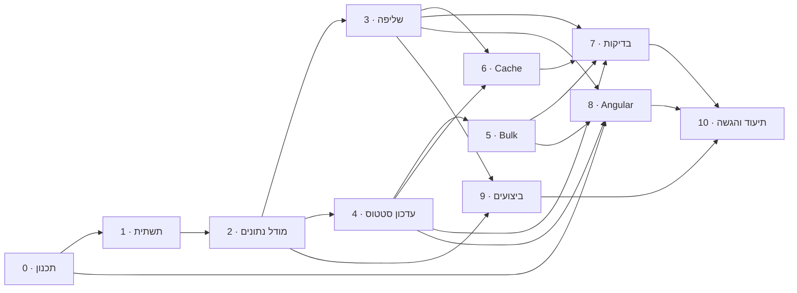

# תוכנית עבודה וחלוקה למשימות

המסמך מתרגם את אפיון המבדק לתוכנית עבודה: אילו דרישות יש, מה הוחלט במקומות שהאפיון לא מגדיר, אילו משימות נגזרו מהדרישות, באיזה סדר הן מבוצעות, ממה כל אחת תלויה וכמה זמן היא אמורה לקחת.

הודעת כל Commit בפרויקט כוללת את מזהה המשימה שהוא מממש (למשל `feat(api): search with combined filters, sorting and paging (Q1, Q2)`), כך שאפשר לעקוב מדרישה, למשימה, לקוד.

## 1. הדרישות

| מזהה | סעיף באפיון | מה נדרש | משימות |
|---|---|---|---|
| R1 | 1. שליפת נתונים | דפדוף, סינון משולב, חיפוש טקסט, מיון, Aggregations, ולידציה, `CancellationToken`, DTOs – הכול בצד השרת | Q1–Q4 |
| R2 | 2. עדכון סטטוס ותחרותיות | 404, ולידציה של הסטטוס ושל המעבר, Optimistic Concurrency (409), עדכון `UpdatedAt` ו-`RowVersion`, מניעת Lost Update | M1, M2, U1, U2 |
| R3 | 3. היסטוריית שינויים | Audit לכל שינוי סטטוס, ו-Endpoint לצפייה בהיסטוריה | M1, U1, Q3 |
| R4 | 4. פעולת Bulk | עד 100 פניות בבקשה אחת, והתנהגות מוגדרת כשחלק מהן נכשלות | B1, B2 |
| R5 | 5. Angular | פעולות בצד השרת, Debounce, ביטול בקשות, מצבי Loading/Empty/Error, טיפול ב-409, Aggregations, היסטוריה, הפרדת אחריות | A1–A8 |
| R6 | 6. ביצועים | מדידה על 100,000 רשומות, Execution Plan, אינדקסים, צוואר בקבוק והצעת שיפור | M2, F1–F3 |
| R7 | 7. Cache | Expiration, Invalidation, נימוק, התאמה לכמה מופעי שרת | C1, C2 |
| R8 | 8. בדיקות אוטומטיות | לפחות 4 בדיקות משמעותיות, כולל Integration ו-Concurrency | T1–T3, A8 |
| R9 | 9. תכנון עבודה | המסמך הזה | P1–P3 |
| R10 | 10. איכות הקוד | מבנה, DI ו-Lifetimes, Async, טיפול גלובלי בשגיאות, ולידציה, Logging | S1, S3, U2 |
| R11 | 11. תיעוד | README: הרצה, גרסאות, מבנה, החלטות, מגבלות, שימוש ב-AI | W1–W3 |
| D | נתוני בדיקה | לפחות 100,000 פניות, ואפשרות ליצור אותן מחדש | M3 |

### הנחות – מה שהאפיון לא מגדיר

* **מעברי סטטוס מותרים.** האפיון דורש לחסום "מעבר שאינו מותר" אבל לא מגדיר אילו מותרים. זו ההנחה:

  | מסטטוס | לסטטוס |
  |---|---|
  | חדשה (`New`) | בטיפול, ממתינה |
  | בטיפול (`InProgress`) | ממתינה, הושלמה |
  | ממתינה (`Waiting`) | בטיפול, הושלמה |
  | הושלמה (`Completed`) | בטיפול (פתיחה מחדש) |

* **Bulk בכשל חלקי.** הצלחה חלקית: כל פנייה מעובדת בנפרד ומקבלת תוצאה משלה (עודכנה / לא נמצאה / התנגשות / מעבר אסור). הנימוק בסעיף ההחלטות.
* **מי ביצע את השינוי.** באפיון אין הזדהות. שם המשתמש לצורך ה-Audit מגיע מהממשק בכותרת `X-User-Name`. בייצור הוא יגיע מה-Token של המשתמש המחובר.
* **סינון לפי ארגון ומטפל.** "מתחיל ב-" – כך SQL Server יכול להשתמש באינדקס. החיפוש החופשי הוא "מכיל", בכותרת ובשם הארגון, כנדרש.
* **טווח תאריכים.** המשתמש בוחר ימים לפי השעון המקומי שלו. הלקוח שולח את תחילת היום הראשון ואת תחילת היום שאחרי האחרון (UTC), והשרת מסנן בטווח חצי פתוח: `from <= CreatedAt < to`.
* **Aggregations.** ספירה לפי סטטוס, ספירה לפי עדיפות, וחמשת המטפלים עם הכי הרבה פניות פתוחות – כולן לפי אותם סינונים כמו הרשימה, כך שהסיכום תמיד מתאים למה שרואים.

## 2. החלטות מרכזיות

| # | נושא | החלטה | למה |
|---|---|---|---|
| 1 | גרסאות | ‎.NET 9 + EF Core 9, ‏Angular 21, ‏SQL Server | הגרסאות שמותקנות בסביבת הפיתוח. Angular 21 עובד עם Node 20.19 / 22.12 ומעלה. התמיכה ב-‎.NET 9 מסתיימת ב-10.11.2026; המעבר ל-‎.NET 10 הוא שינוי של ה-TargetFramework וגרסאות החבילות |
| 2 | מבנה השרת | ארבעה פרויקטים: Domain, ‏Application, ‏Infrastructure, ‏Api | לכל שכבה אחריות אחת, והקומפיילר אוכף את כיוון התלויות. כללי העסק נבדקים בלי בסיס נתונים |
| 3 | גישה לנתונים | EF Core Code First עם Migrations. קריאה: הטלה ל-DTO בתוך השאילתה. כתיבה: טעינת הישות, שינוי דרך מתודה של הישות, ושמירה | רק העמודות והשורות הנדרשות יוצאות מבסיס הנתונים. שכבת Application לא מכירה את EF Core |
| 4 | תחרותיות | עמודת `rowversion` של SQL Server כ-Concurrency Token. הלקוח שולח את הגרסה שקרא, ובהתנגשות מקבל 409 | ההגנה נאכפת בבסיס הנתונים, בתוך פקודת ה-UPDATE עצמה – אין חלון בין הבדיקה לכתיבה |
| 5 | חוזה שגיאות | Problem Details (RFC 9457) לכל שגיאה: 400 ולידציה, 404 לא נמצא, 409 התנגשות, 422 מעבר סטטוס אסור | פורמט אחד שהלקוח מפענח במקום אחד, וכל קוד אומר משהו אחר |
| 6 | Audit | שורת היסטוריה נוספת לישות ונשמרת באותו `SaveChanges` כמו השינוי | השינוי וההיסטוריה נשמרים יחד או לא נשמרים בכלל |
| 7 | Bulk | הצלחה חלקית, תוצאה לכל פנייה, כל פנייה בטרנזקציה משלה | פנייה אחת שמישהו שינה בינתיים לא חוסמת את כל השאר. כל פנייה עדיין מוגנת בבדיקת גרסה |
| 8 | Cache | `IMemoryCache` לנתונים המסכמים של התצוגה ללא סינון: תפוגה של 60 שניות, וניקוי אחרי כל שינוי סטטוס | זה המסך שכולם מגיעים אליו והחישוב היקר ביותר (כל הטבלה). תצוגות מסוננות מצומצמות יותר ומשתמשות באינדקסים |
| 9 | ממשק | Angular 21 – רכיבי Standalone ו-Signals, ‏Angular Material, עברית מימין לשמאל | רכיבים מוכנים ונגישים (טבלה, דפדוף, מיון, דיאלוג). המשתמשים דוברי עברית |
| 10 | מצב הרשימה בלקוח | שירות מצב אחד (`RequestsStateService`) עם Signals, וצינור RxJS: ‏`debounceTime` ואז `switchMap` | פחות בקשות לשרת, ותשובה ישנה לעולם לא דורסת תשובה חדשה |
| 11 | נתוני בדיקה | 100,000 פניות שנוצרות מ-Seed קבוע ונטענות ב-`SqlBulkCopy`: אוטומטית בהרצה הראשונה, ובפקודת `seed` ליצירה מחדש | הבודק לא צריך צעד נוסף, וכל יצירה מחדש מייצרת אותם נתונים |
| 12 | בדיקות | xUnit. בדיקות Integration מול SQL Server אמיתי, עם בסיס נתונים נפרד לכל מחלקת בדיקות | רק SQL Server מייצר `rowversion`. בדיקת Concurrency מול ספק אחר לא בודקת את המנגנון האמיתי |
| 13 | CI | GitHub Actions: בנייה, בדיקות שרת מול SQL Server בקונטיינר, בנייה ובדיקות לקוח | כל שינוי נבדק אוטומטית, ומצב הבדיקות גלוי לבודקים |

## 3. מבנה הפתרון

```text
src/
  EmployerRequests.Api/             HTTP: ‏Controllers, ‏ErrorHandling, ‏Program.cs (כל רישומי ה-DI)
  EmployerRequests.Application/     הלוגיקה: ‏DTOs, ‏Interfaces, ‏Services (‏RequestService, ‏SummaryCache), ‏Mapping, ‏Exceptions
  EmployerRequests.Domain/          הישויות וכללי העסק – בלי תלות בשום ספרייה
  EmployerRequests.Infrastructure/  בסיס הנתונים: ‏Data (‏AppDbContext, ‏Migrations, ‏TestDataSeeder), ‏Repositories
tests/
  EmployerRequests.UnitTests/       כללי העסק, ולידציה, Cache, לוגיקת Bulk
  EmployerRequests.IntegrationTests/ ה-API כולו מול SQL Server אמיתי
client/                             Angular 21: ‏components, ‏services, ‏models, ‏interceptors, ‏pipes, ‏utils
docs/                               תוכנית עבודה, ביצועים
```

**כיוון התלויות:** `Api → Application → Domain`, ו-`Infrastructure → Application`; ‏Api מכיר גם את Infrastructure, כדי לרשום אותו ב-DI. ה-Application מגדיר את `IRequestRepository`, ו-Infrastructure מממש אותו. בתוך הפרויקטים – החלוקה המוכרת: Controller ← Service ← Repository ← DbContext.

## 4. המשימות

עמודות: **מזהה** · **משימה** · **מה נדרש** · **תוצר** · **תלויה ב-** · **הערכה** (שעות עבודה נטו) · **דרישה**.

### Epic 0 – הכנה ותכנון

| מזהה | משימה | מה נדרש | תוצר | תלויה ב- | הערכה | דרישה |
|---|---|---|---|---|---|---|
| P1 | ניתוח האפיון | מיפוי הדרישות למזהים; זיהוי מה שהאפיון לא מגדיר וקביעת הנחות | טבלת דרישות והנחות (סעיף 1) | – | 1.5 | R9 |
| P2 | החלטות ארכיטקטורה | שכבות, מנגנון Concurrency, חוזה שגיאות, Bulk, Cache, גרסאות – עם נימוק לכל החלטה | סעיף 2 | P1 | 1.5 | R9, R10 |
| P3 | תוכנית עבודה | פירוק למשימות, הערכות, תלויות, סדר ביצוע, סיכונים | המסמך הזה | P2 | 1 | R9 |

### Epic 1 – תשתית

| מזהה | משימה | מה נדרש | תוצר | תלויה ב- | הערכה | דרישה |
|---|---|---|---|---|---|---|
| S1 | Solution ומבנה | ארבעה פרויקטים ושני פרויקטי בדיקות; `Directory.Build.props` (‏Nullable, ‏Warnings as errors); ניהול גרסאות מרכזי (`Directory.Packages.props`); ‏`.editorconfig`, ‏`.gitignore` | Solution שנבנה נקי | P3 | 1.5 | R10 |
| S2 | CI | GitHub Actions: בנייה ובדיקות שרת מול SQL Server בקונטיינר; בנייה ובדיקות לקוח | `.github/workflows/ci.yml` | S1 | 1.5 | R8, R11 |
| S3 | צנרת ה-API | Controllers; Enums כשמות ב-JSON; ‏Problem Details; ‏`GlobalExceptionHandler`; ‏Logging; ‏Swagger; הרכבת DI עם Lifetimes נכונים | API ריק שרץ ומחזיר שגיאות אחידות | S1 | 2 | R10 |

### Epic 2 – מודל נתונים

| מזהה | משימה | מה נדרש | תוצר | תלויה ב- | הערכה | דרישה |
|---|---|---|---|---|---|---|
| M1 | מודל הדומיין | `ServiceRequest`, ‏`RequestStatus`, ‏`RequestPriority`; כללי המעבר במקום אחד (`StatusWorkflow`); ‏`ChangeStatus` שבודק את המעבר, מעדכן `UpdatedAt` ומוסיף שורת היסטוריה | Domain | S1 | 2 | R2, R3 |
| M2 | EF Core ו-Migration | `AppDbContext`; קונפיגורציה: אורכי שדות, Enums כ-`tinyint`, ‏`rowversion`, ‏FK להיסטוריה; אינדקסים לפי דפוסי השאילתות; Migration ראשון | סכמה בבסיס הנתונים | M1 | 2 | R2, R3, R6 |
| M3 | נתוני בדיקה | 100,000 פניות בעברית מ-Seed קבוע (התפלגות סטטוסים, עדיפויות ותאריכים); ‏`SqlBulkCopy`; טעינה אוטומטית כשהטבלה ריקה; פקודת `seed` ליצירה מחדש | 100,000 פניות זהות בכל יצירה | M2 | 2.5 | D |

### Epic 3 – שליפה (R1)

| מזהה | משימה | מה נדרש | תוצר | תלויה ב- | הערכה | דרישה |
|---|---|---|---|---|---|---|
| Q1 | חוזה החיפוש וולידציה | `RequestSearchDto`: גבולות `page` / `pageSize` (עד 100), שדות מיון מתוך רשימה סגורה, ערכי Enum חוקיים, טווח תאריכים תקין; 400 עם שם השדה | פרמטרים מאומתים | S3, M1 | 1.5 | R1 |
| Q2 | השאילתה | סינונים משולבים ב-AND; חיפוש "מכיל"; מיון יציב (`Id` כשובר שוויון); ‏`COUNT` ועמוד אחד ב-`OFFSET/FETCH`; הטלה ל-DTO; ‏`CancellationToken` עד EF | `GET /api/requests` | Q1, M2 | 3 | R1 |
| Q3 | פרטים והיסטוריה | פנייה אחת, כולל הסטטוסים שמותר לעבור אליהם; היסטוריה מהחדש לישן; 404 | `GET /api/requests/{id}`, ‏`/history` | M2, S3 | 1.5 | R1, R3 |
| Q4 | Aggregations | `GROUP BY` אחד לפי סטטוס ועדיפות; חמשת המטפלים העמוסים; אותם סינונים כמו הרשימה | `GET /api/requests/summary` | Q2 | 2 | R1 |

### Epic 4 – עדכון סטטוס ותחרותיות (R2, R3)

| מזהה | משימה | מה נדרש | תוצר | תלויה ב- | הערכה | דרישה |
|---|---|---|---|---|---|---|
| U1 | עדכון סטטוס | טעינה; השוואת הגרסה שהלקוח קרא; בדיקת המעבר; שמירה עם שורת היסטוריה באותה טרנזקציה; החזרת הגרסה החדשה | `PATCH /api/requests/{id}/status` | M2, S3 | 2.5 | R2, R3 |
| U2 | חוזה השגיאות של העדכון | 404, ‏409, ‏422 כ-Problem Details מה-`GlobalExceptionHandler`; Logging של שינוי והתנגשות | תשובות שגיאה ברורות | U1 | 1 | R2, R10 |

### Epic 5 – Bulk (R4)

| מזהה | משימה | מה נדרש | תוצר | תלויה ב- | הערכה | דרישה |
|---|---|---|---|---|---|---|
| B1 | חוזה וולידציה | 1–100 פריטים, בלי כפילויות, גרסה לכל פריט; בקשה לא תקינה מחזירה 400 ושום דבר לא מתעדכן | `BulkChangeStatusDto` | U1 | 1 | R4 |
| B2 | עיבוד ותוצאות | אותה לוגיקה של עדכון בודד, לכל פריט בנפרד; תוצאה לכל פריט ובסדר הבקשה; סיכום הצליחו / נכשלו | `PATCH /api/requests/status` | B1 | 1.5 | R4 |

### Epic 6 – Cache (R7)

| מזהה | משימה | מה נדרש | תוצר | תלויה ב- | הערכה | דרישה |
|---|---|---|---|---|---|---|
| C1 | Cache לנתונים המסכמים | `SummaryCache` (Singleton) מעל `IMemoryCache`; תפוגה של 60 שניות; ניקוי אחרי כל עדכון (בודד ו-Bulk); הגנה ממרוץ בין חישוב לעדכון | סיכום ללא סינון מהזיכרון | Q4, U1 | 2 | R7 |
| C2 | כמה מופעי שרת | תכנון המעבר ל-Cache מבוזר (Redis) ולהודעות ניקוי בין מופעים | סעיף Cache ב-README | C1 | 0.5 | R7, R11 |

### Epic 7 – בדיקות אוטומטיות (R8)

| מזהה | משימה | מה נדרש | תוצר | תלויה ב- | הערכה | דרישה |
|---|---|---|---|---|---|---|
| T1 | בדיקות יחידה | מעברי סטטוס; ‏`ChangeStatus`; ולידציית פרמטרים; ‏Cache (כולל המרוץ); לוגיקת ה-Bulk מול Repository מדומה | בדיקות יחידה | M1, Q1, C1, B2 | 2.5 | R8 |
| T2 | תשתית Integration | `WebApplicationFactory` מול SQL Server אמיתי; בסיס נתונים לכל מחלקת בדיקות, מה-Migration האמיתי | `ApiFactory` | M2, S3 | 1.5 | R8 |
| T3 | בדיקות Integration | שליפה וסינון; 400; עדכון, 404, 422; ‏409 בלי דריסה; עדכונים מקבילים – בדיוק אחד מצליח; ‏Bulk עם תוצאות מעורבות; היסטוריה | בדיקות | T2, Q2, Q3, U2, B2 | 3 | R1–R4, R8 |

### Epic 8 – Angular (R5)

| מזהה | משימה | מה נדרש | תוצר | תלויה ב- | הערכה | דרישה |
|---|---|---|---|---|---|---|
| A1 | שלד האפליקציה | Angular 21; ‏Material; עברית מימין לשמאל; Proxy ל-API; ‏Interceptor שמוסיף את שם המשתמש | אפליקציה שרצה | P3 | 1.5 | R5 |
| A2 | שכבת ה-API | מודלים שתואמים ל-DTOs; שירות HTTP; תרגום Problem Details להודעות בעברית | `RequestsApiService` | A1, Q1 | 1.5 | R5 |
| A3 | שירות המצב של הרשימה | מצב הסינון והדפדוף; ‏`switchMap` שמבטל בקשה קודמת; מצבי Loading / Empty / Error | `RequestsStateService` | A2 | 2 | R5 |
| A4 | סינון, טבלה, מיון ודפדוף | Debounce לשדות הטקסט; טבלה עם מיון ודפדוף בצד השרת | רכיבי סינון וטבלה | A3 | 3 | R5 |
| A5 | סיכום | הצגת ה-Aggregations; טעינה מחדש כשמשתנה הסינון ואחרי עדכון | רכיב סיכום | A3, Q4 | 1.5 | R5 |
| A6 | פרטים, עדכון והיסטוריה | פרטי פנייה; רק הסטטוסים המותרים; שליחת הגרסה; ב-409 – הסבר וטעינת המצב העדכני; היסטוריה | דיאלוג פרטים | A3, Q3, U2 | 3 | R2, R3, R5 |
| A7 | Bulk בממשק | בחירת פניות; עדכון מרוכז; תוצאה לכל פנייה שלא עודכנה | סרגל Bulk | A4, B2 | 2 | R4, R5 |
| A8 | בדיקות Angular | שירות המצב (ביטול בקשה), ‏Debounce, תרגום שגיאות, טיפול ב-409 | Specs | A5, A6, A7 | 2 | R5, R8 |

### Epic 9 – ביצועים (R6)

| מזהה | משימה | מה נדרש | תוצר | תלויה ב- | הערכה | דרישה |
|---|---|---|---|---|---|---|
| F1 | מדידה על 100,000 | ה-SQL המדויק ש-EF שולח; ‏`STATISTICS IO/TIME`; ‏Actual Execution Plans; השוואה עם ובלי אינדקס; זמני תגובה של ה-API | מספרים ותוכניות ביצוע | M3, Q2, Q4 | 2.5 | R6 |
| F2 | ניתוח וכוונון | אינדקס שלא עוזר – יוסר; שאילתה שסורקת – תתוקן; זיהוי צוואר הבקבוק והצעת שיפור | אינדקסים מוצדקים במדידה | F1 | 2 | R6 |
| F3 | מסמך ביצועים | איך נמנעת טעינה לזיכרון, האינדקסים ולמה, צוואר בקבוק והצעה | `docs/PERFORMANCE.md` | F2 | 1.5 | R6, R11 |

### Epic 10 – תיעוד והגשה (R11)

| מזהה | משימה | מה נדרש | תוצר | תלויה ב- | הערכה | דרישה |
|---|---|---|---|---|---|---|
| W1 | README | הרצה (LocalDB ו-Docker), גרסאות, מבנה, API, בסיס נתונים, Concurrency, ‏Bulk, ‏Cache, שתי החלטות עם חלופות, מגבלה ושיפור | `README.md` | C2, T1, T3, A8, F3 | 3 | R11 |
| W2 | שימוש ב-AI | באילו חלקים נעשה שימוש, ומה נבדק או שונה ידנית | סעיף ב-README | W1 | 0.5 | R11 |
| W3 | בדיקת הגשה | Clone נקי, הרצה לפי ה-README, ‏CI ירוק | מאגר מוכן להגשה | W2 | 1 | R11 |

## 5. סדר ביצוע ותלויות



**שלבים:**
1. **תכנון** – P1 → P2 → P3.
2. **תשתית ומודל** – S1, ואחריו S2, ‏S3 ו-M1 → M2 → M3. שלד ה-Angular (A1) יכול להתחיל כבר כאן, במקביל.
3. **API** – שליפה (Q1–Q4), עדכון (U1–U2), ‏Bulk (B1–B2), ואז Cache (C1–C2). בדיקות ה-Integration (T2–T3) נכתבות לצד כל יכולת, ולא בסוף.
4. **Angular** – A2 → A3, ואז A4–A7 לפי התלויות, ובסוף A8.
5. **ביצועים** – F1 → F2 → F3, אחרי שיש נתונים ושאילתות סופיות.
6. **תיעוד והגשה** – W1 → W2 → W3.

**הנתיב הקריטי** (השרשרת הארוכה ביותר של תלויות, 25 שעות):
P1 → P2 → P3 → S1 → M1 → M2 → Q2 → Q4 → F1 → F2 → F3 → W1 → W2 → W3.
מפתחת אחת מבצעת את המשימות ברצף, כך שהמאמץ הכולל הוא סכום ההערכות. הנתיב הקריטי מראה מה חייב להסתיים לפני מה, ואילו משימות אפשר להזיז בלי לעכב את ההגשה (למשל A1, ‏S2, ‏C2).

## 6. סיכום מאמץ

| Epic | משימות | הערכה (שעות) |
|---|---|---|
| 0 – הכנה ותכנון | 3 | 4 |
| 1 – תשתית | 3 | 5 |
| 2 – מודל נתונים | 3 | 6.5 |
| 3 – שליפה | 4 | 8 |
| 4 – עדכון סטטוס ותחרותיות | 2 | 3.5 |
| 5 – Bulk | 2 | 2.5 |
| 6 – Cache | 2 | 2.5 |
| 7 – בדיקות אוטומטיות | 3 | 7 |
| 8 – Angular | 8 | 16.5 |
| 9 – ביצועים | 3 | 6 |
| 10 – תיעוד והגשה | 3 | 4.5 |
| **סה"כ** | **36** | **66** |

בנוסף למאמץ: מאגר של כ-10% (כ-7 שעות) לבעיות שיתגלו בבדיקות ובמדידות.

## 7. סיכונים

| סיכון | השפעה | איך מצמצמים |
|---|---|---|
| באג ב-Concurrency | דריסה שקטה של שינוי של משתמש אחר – הבאג הכי חמור שיכול להיות כאן | בדיקות Integration מול SQL Server אמיתי, כולל עדכונים מקבילים עם אותה גרסה |
| שאילתת LINQ שמתורגמת לסריקה | איטיות על 100,000 רשומות, שלא רואים על נתונים קטנים | בדיקת ה-SQL ש-EF שולח ומדידה על 100,000 (F1) |
| סביבת הרצה אצל הבודקים | LocalDB קיים רק ב-Windows | `docker-compose.yml` עם SQL Server, והוראות לשני המסלולים |
| ‏RTL ב-Angular Material | רכיבים שמוצגים הפוך | `dir="rtl"` ברמת המסמך ובדיקה בדפדפן של כל מסך |

## 8. מתי משימה גמורה

* הקוד נבנה בלי אזהרות (אזהרות מוגדרות כשגיאות).
* להתנהגות החשובה של המשימה יש בדיקה, וכל הבדיקות עוברות ב-CI.
* התיעוד הרלוונטי עודכן.
* הודעת ה-Commit כוללת את מזהה המשימה.
